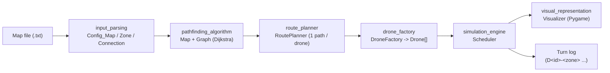
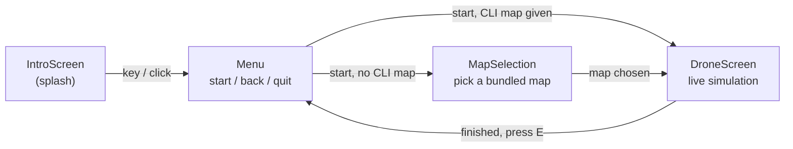

<!--
:<<'MDEOF'
-->
*This project has been created as part of the 42 curriculum by jawosylu.*

# Fly-In

**Autonomous multi-drone routing and turn-by-turn simulation, with a live
Pygame visualization.**

[](https://www.python.org/)
[](https://mypy-lang.org/)
[](https://flake8.pycqa.org/)
[](https://docs.astral.sh/uv/)
[](#algorithm-explanation)

## Highlights

- **Zero graph libraries** — `Map`, `Graph.shortest_distance` (Dijkstra) and
  the whole scheduler are hand-written, as required by the subject's
  [Constraints](#subject-requirements-at-a-glance).
- **Congestion-aware routing** — each drone is routed with a Dijkstra weight
  function that penalizes zones/connections already reserved by earlier
  drones, spreading the fleet across parallel paths instead of funneling
  everyone through the same bottleneck.
- **Full turn-by-turn Pygame simulation** — pause, single-step forward *and
  backward* through the exact turn history, or restart from scratch.
- **`mypy --strict` + `flake8` clean**, fully object-oriented, documented
  with PEP 257 docstrings throughout.
- **28 hand-built test maps** (`maps/`), from linear warm-ups to a
  deliberately near-unsolvable 25-drone challenger map, plus a dedicated
  `maps/critical/` suite that isolates the rule interactions that are
  easiest to get subtly wrong.

## Description

Fly-In is a drone routing and simulation system. Given a map of connected
zones (a graph) with a single start and end hub, it computes a path for
every drone, then runs a turn-by-turn simulation that moves all drones from
the start to the end zone while respecting:

- **Zone occupancy limits** (`max_drones`), with the start and end zones
  exempt from the limit.
- **Connection capacity limits** (`max_link_capacity`).
- **Zone-type movement costs**: `normal`/`priority` zones cost 1 turn,
  `restricted` zones cost 2 turns (and cannot be waited on mid-transit),
  `blocked` zones cannot be entered at all.

The goal is to deliver every drone in as few simulation turns as possible.
The project is written entirely from scratch in Python — no graph library
(`networkx`, `graphlib`, ...) is used — and is fully object-oriented and
type-safe (`mypy --strict`, `flake8`).

The simulation can be watched live in a Pygame window, or (without a map
argument) explored through an in-app menu that lets you pick one of the
bundled example maps.

## Screenshots

| Intro | Menu |
| :--: | :--: |
|  |  |

| Map selection | Live simulation |
| :--: | :--: |
|  |  |

The simulation screenshot above shows `maps/medium/03_priority_puzzle.txt`
mid-run: drones (the small X-shaped sprites) in transit between zones, live
`occupancy/capacity` labels under `fast_junction` and `merge_point`, the
red `restricted` zones on the slow upper path, and the running turn log in
the bottom-right panel. The `Left arrow`/`Right arrow` hint in the top-right
legend shows the step-by-step turn navigation described in
[Visual representation](#visual-representation).

## Project structure

```
src/
├── __main__.py               # CLI entry point: wires every stage together
├── argparsing.py             # --map command-line flag
├── input_parsing.py          # Map file parser + pydantic Zone/Connection models
├── pathfinding_algorithm.py  # Graph (Map) + Dijkstra shortest paths
├── route_planner.py          # Congestion-aware path assignment (1 path/drone)
├── drone_factory.py          # Drone state machine + fleet construction
├── simulation_engine.py      # Turn-by-turn Scheduler enforcing all constraints
├── visual_representation.py  # Pygame scenes: intro, menu, map select, sim view
└── visual/                   # Reusable Pygame building blocks
    ├── background.py         #   parallax scrolling background
    ├── particle.py           #   snowfall particle system
    ├── drone.py               #   animated drone sprite
    └── basescene.py           #   Scene/BaseScene interface shared by every screen
```

Data flows from a map file to an on-screen simulation in one direction —
each stage only depends on the plain data produced by the previous one, not
on how it was computed:



## Instructions

The project uses [uv](https://docs.astral.sh/uv/) to manage its virtual
environment and dependencies, and exposes everything through the `Makefile`:

```sh
make install      # uv sync — create the venv and install dependencies
make run           # uv run python -m src
make debug         # run the main script under pdb
make clean         # remove __pycache__ and .mypy_cache
make fclean        # clean + remove the virtual environment
make lint          # flake8 . && mypy . <required flags>
make lint-strict    # flake8 . && mypy . --strict
```

Running `make run` without any flags opens the interactive Pygame menu,
where a map can be chosen from the list. A specific map can also be loaded
directly on the command line:

```sh
uv run python -m src --map ./maps/easy/01_linear_path.txt
```

The window opens sized to fit your screen (85% of the desktop resolution,
keeping a 16:9 layout) and can be freely resized or maximized afterwards.

Controls in the simulation view:

| Key | Effect |
| --- | --- |
| `Space` | Pause / unpause the simulation |
| `Right arrow` | While paused, advance a single turn |
| `Left arrow` | While paused, step back to the previous turn |
| `R` / **Retry** button | Restart the simulation from turn 0 |
| `E` | Once finished, return to the menu |
| `Esc` | Quit |

Map files follow the format described in the project subject
(`nb_drones`, `start_hub`, `end_hub`, `hub`, `connection` lines with
optional `[key=value]` metadata). Example maps of increasing difficulty are
provided under [maps/](maps/), documented in [maps/README.md](maps/README.md).

## Example input and expected output

Input ([maps/easy/02_simple_fork.txt](maps/easy/02_simple_fork.txt)):

```text
nb_drones: 3

start_hub: start 0 0 [color=green]
hub: junction 1 0 [color=yellow max_drones=2]
hub: path_a 2 1 [color=blue]
hub: path_b 2 -1 [color=blue]
hub: path_c 2 0
end_hub: goal 3 0 [color=red max_drones=3]

connection: start-junction
connection: junction-path_a
connection: junction-path_b
connection: path_a-goal
connection: path_b-goal
```

Command:

```sh
uv run python -m src --map ./maps/easy/02_simple_fork.txt
```

After choosing *start* in the menu, every simulated turn is printed to the
terminal (one line per turn, only the drones that move) while the Pygame
window animates it:

```text
D0-junction
D0-path_a D1-junction
D0-goal D1-path_b D2-junction
D1-goal D2-path_a
D2-goal
```

The simulation ends after 5 turns, when all three drones are in `goal`.
For a restricted zone a drone that is in flight is listed with the
connection (`D<id>-<from>-<to>`) and lands on the next turn
(see [maps/medium/02_circular_loop.txt](maps/medium/02_circular_loop.txt)):

```text
D0-start-loop_a
D0-loop_a
D0-loop_a-loop_b D1-start-loop_a
```

An invalid map stops the program with exit status 1 and a message on
`stderr` that names the file, the line and the cause:

```text
$ uv run python -m src --map bad.txt
bad.txt:3: Invalid zone definition: "zone": Input should be 'normal', 'blocked', 'restricted' or 'priority' (got 'lava')
```

A map without any route from start to end is reported as well:

```text
Invalid config file: No valid path from start to endhub
```

## Algorithm explanation

The routing/simulation pipeline is split into independent stages, each in
its own module:

1. **Parsing** ([src/input_parsing.py](src/input_parsing.py)) reads the map
   file line by line into a raw key/value structure, then validates it into
   typed `pydantic` models (`Zone`, `Connection`). Any structural or
   semantic error (unknown key, invalid zone type, malformed metadata, ...)
   raises `InputParsingError` and aborts with exit status 1 and a message of
   the form `file:line: cause`, e.g.
   `map.txt:3: Invalid zone definition: "max_drones": Input should be greater than 0 (got '0')`.
   Besides the syntax, the parser enforces the rules of the subject:
   `nb_drones` must be the first line and a positive integer (there is no
   upper limit), exactly one `start_hub` and one `end_hub`, unique zone names
   without dashes, integer coordinates, capacities that are positive
   integers, valid zone types, and connections that link two *previously
   defined*, different zones and are not duplicated (`a-b` equals `b-a`).
   Metadata must be a single, closed `[key=value ...]` block at the end of
   the line, and every key may appear only once.

2. **Graph** ([src/pathfinding_algorithm.py](src/pathfinding_algorithm.py))
   builds an adjacency-list graph (`Map`) from the parsed zones and
   connections, skipping `blocked` zones entirely so they can never be
   entered. Connections that touch a blocked zone are dropped from the graph
   (a blocked zone is valid, just inaccessible), while connections to a zone
   that is not defined at all are an error. If no route from start to end
   remains, a clear "no valid path" error is raised.
   `Graph.shortest_distance` implements **Dijkstra's algorithm**
   from scratch (using `heapq`) with a pluggable edge-weight function,
   defaulting to the destination zone's movement cost.

3. **Route planning** ([src/route_planner.py](src/route_planner.py))
   assigns one shortest path per drone. Instead of giving every drone the
   same globally-shortest path (which would funnel every drone through the
   same bottleneck), `RoutePlanner` runs Dijkstra once per drone with a
   **congestion-aware weight function**: each zone/connection already
   reserved by a previously-routed drone adds a penalty proportional to
   `load / capacity`, and `priority` zones get a small bias to be preferred
   when a tie needs breaking. This naturally spreads drones across disjoint
   or parallel paths without needing a full multi-commodity-flow solver.

4. **Simulation** ([src/simulation_engine.py](src/simulation_engine.py))
   is a turn-based `Scheduler`. Each turn runs the same four steps:

   ```mermaid
   flowchart TD
       A["1. Land completed transits\n(restricted-zone arrivals)"] --> B["2. Sort movable drones\n(longest-blocked first, then\nshortest remaining path)"]
       B --> C{"3. Repeat until nothing changes:\ncan a drone enter its next zone\n(zone + link capacity free)?"}
       C -- "yes" --> D["Move / start transit\nrecord D&lt;id&gt;-&lt;target&gt;"]
       C -- "no" --> E["mark_blocked()\nretry next turn"]
       D --> F{"4. Any move happened\nthis turn?"}
       E --> F
       F -- "no, or turn cap reached" --> G["raise SchedulerDeadlockError"]
       F -- "yes, drones remain" --> A
       F -- "all drones delivered" --> H["done"]
   ```

   Drones that cannot move immediately are retried within the same turn
   until no more drone can advance. This lets a drone move into a zone that
   another drone leaves in that very turn (as the subject requires),
   regardless of the order the drones are processed in. The same hand-off
   principle is applied to connections too: a connection a drone finishes
   transiting on this turn is free again for another drone to start a new
   transit on, in that same turn, instead of sitting idle for one wasted
   turn. A turn cap (`longest path + zones × drones`) bounds the simulation;
   if a turn produces no movement at all, or the cap is exceeded,
   `SchedulerDeadlockError` is raised with the state of every stuck drone.

5. **Drone bookkeeping** ([src/drone_factory.py](src/drone_factory.py))
   models each drone as a small state machine, keeping the simulation
   engine focused on scheduling rather than per-drone state:

   ```mermaid
   stateDiagram-v2
       [*] --> delivered: empty path (already at end)
       [*] --> can_move: has a path
       can_move --> can_move: move() into a normal/priority zone
       can_move --> on_way: start_transit() into a restricted zone
       on_way --> can_move: complete_transit(), path remains
       on_way --> delivered: complete_transit(), path empty
       can_move --> delivered: move(), path empty
   ```

**Complexity**: each `Dijkstra` run is `O((V + E) log V)`; route planning
runs it once per drone, so path assignment is `O(D · (V + E) log V)` for
`D` drones. The simulation itself is `O(T · D log D)` for `T` turns
(dominated by sorting movable drones each turn). Paths are computed once
up front and then simply consumed turn by turn — no re-planning happens
during the simulation, keeping memory usage at `O(V + E + D)` for the
graph and drone paths.

## Performance

Turns needed by this implementation compared with the reference targets of
the subject (fewer is better; every map is solved in well under a second):

| Map | Drones | Turns | Target |
| --- | --- | --- | --- |
| easy / linear path | 2 | 4 | ≤ 6 |
| easy / simple fork | 3 | 5 | ≤ 6 |
| easy / basic capacity | 4 | 6 | ≤ 8 |
| medium / dead end trap | 5 | 8 | ≤ 15 |
| medium / circular loop | 6 | 20 | ≤ 20 |
| medium / priority puzzle | 4 | 8 | ≤ 12 |
| hard / maze nightmare | 8 | 18 | ≤ 45 |
| hard / capacity hell | 12 | 23 | ≤ 60 |
| hard / ultimate challenge | 15 | 29 | ≤ 35 |
| challenger / impossible dream (optional) | 25 | 62 | record: 45 |

All mandatory targets are met, with turns equal to or fewer than every
target — the bonus part's "exceptional performance" bar (VII/IX of the
subject). The optional challenger map is solved correctly but does not
beat the reference record.

## Visual representation

The Pygame front end ([src/visual_representation.py](src/visual_representation.py)
and [src/visual/](src/visual/)) is built as a small stack of `Scene`s, each
sharing a parallax scrolling background and a snowfall particle system for
a consistent look. `Visualizer.run` keeps a `list[Scene]` and always draws
its top ([src/visual_representation.py](src/visual_representation.py)):



The simulation view (`DroneScreen`) is the core visualization:

- The network is laid out by scaling each zone's raw `(x, y)` coordinates
  to fit the window, then drawing every connection as a line and every
  zone as a tinted icon (tinted with the zone's configured `color`).
- Each zone displays its live `occupancy / capacity`, and each
  capacity-limited connection displays its live `usage / capacity`,
  making it easy to see where drones are queuing up (visible under
  `fast_junction` and `merge_point` in the screenshot above).
- Drones are drawn as an animated sprite that smoothly interpolates
  between the previous and next zone position over the turn interval,
  so multi-drone movement stays readable instead of jumping instantly.
- A scrolling log panel prints the raw per-turn move list (the same
  format used for the textual simulation output), letting the exact
  `D<id>-<zone>` output be cross-checked against what is drawn.
- The turn counter, pause state and step-by-step controls (`Space`,
  `Right arrow`, `Left arrow`) let a reviewer freeze the simulation and
  inspect any single turn in detail — including stepping *backward*
  through turns already played. Stepping back rebuilds the scheduler from
  scratch and replays it up to the target turn (the whole simulation is
  deterministic, so this always reproduces the exact original state)
  rather than keeping a full state snapshot per turn, which is simpler
  and cheap enough for every map this project ships with. A **Retry**
  button (or `R`) restarts the run from turn 0 the same way.
- The window opens sized to the user's screen (`Visualizer._initial_window_size`,
  keeping a 16:9 layout) and stays freely resizable/maximizable afterwards
  (`pg.RESIZABLE | pg.SCALED`), instead of forcing a fixed 1920×1080 window
  that may not fit smaller displays.

This turns the abstract turn log into an at-a-glance, scrubbable view of
congestion, capacity usage and drone progress, which was the main goal of
the visual requirement in the subject.

## Subject requirements at a glance

A quick cross-reference for reviewers, mapping the mandatory part of the
subject to where it is satisfied:

| Subject requirement | Where |
| --- | --- |
| No graph libraries (Constraints) | Hand-written `Map`/`Graph` in [pathfinding_algorithm.py](src/pathfinding_algorithm.py) |
| Fully type-safe, `flake8` + `mypy` (Constraints) | `make lint-strict` → 0 issues on all 14 modules |
| Fully object-oriented (Constraints) | Every stage is a class (`Config_Map`, `Map`, `Graph`, `RoutePlanner`, `DroneFactory`, `Scheduler`, `Visualizer`, ...) |
| Zone occupancy + connection capacity (VII.2) | `Scheduler.capacity` / `_can_enter` / `link_usage` in [simulation_engine.py](src/simulation_engine.py) |
| Same-turn vacate/enter hand-off (VII.3) | `zone_occupancy` decremented before the move phase; see [Algorithm explanation](#algorithm-explanation) |
| Restricted-zone forced 2-turn transit (VII.3) | `Drone.start_transit`/`complete_transit` + `Scheduler.in_flight` |
| Parser rejects malformed input with `file:line:` errors (VII.4) | [input_parsing.py](src/input_parsing.py), see [maps/extra/invalid/](maps/extra/invalid/) |
| Turn-by-turn `D<id>-<zone>` output format (VII.5) | `Scheduler.gen_turn` return value, printed each turn |
| Visual feedback of the simulation (VII.1) | Full Pygame front end, see [Visual representation](#visual-representation) |
| Performance benchmarks (VII.7) | See [Performance](#performance) — every mandatory target met |
| README requirements (VIII) | This file: attribution line, Description, Instructions, Resources + AI usage, algorithm write-up, visual representation write-up |

## Resources

- [Dijkstra's algorithm - Implementation of this algorithm](https://www.datacamp.com/tutorial/dijkstra-algorithm-in-python) - reference for the shortest-path implementation in `Graph.shortest_distance`.
- [Dijkstra's algorithm - wikipedia](https://en.wikipedia.org/wiki/Dijkstra%27s_algorithm) - used for a better understanding of the used algorithm
- [Python `heapq` documentation](https://docs.python.org/3/library/heapq.html) - used for the priority queue in Dijkstra.
- [Pygame documentation](https://www.pyga.me/docs/) - used for the visual representation.
- [Pixelart for the visualisation](https://free-game-assets.itch.io/free-sky-with-clouds-background-pixel-art-set) - used for the background sky in the visualpart
- [Pygame Introduction](https://www.geeksforgeeks.org/python/introduction-to-pygame/) - Introduction to pygame with simple Examples
- [Pygame Video](https://www.youtube.com/watch?v=AY9MnQ4x3zk) - Video about Pygame for a better understanding


### AI usage

AI (an LLM-based coding assistant) was used for several distinct parts of
this project:

- **Pathfinding and scheduling**: as a discussion and debugging partner
  while designing `RoutePlanner`'s congestion-aware Dijkstra weighting and
  the `Scheduler`'s turn-based capacity/deadlock handling — explaining
  algorithmic trade-offs and helping track down scheduling bugs. The
  resulting design was reviewed and is understood by the author.
- **Type safety and documentation**: bringing the whole `src/` tree into
  compliance with `mypy --strict` (adding precise type hints, replacing
  unsound `Optional` attribute access with explicit assertions/guards,
  fixing a dead-code branch in `Visualizer.run`'s scene stack) and writing
  the PEP 257 docstrings for every module, class and function, plus this
  README (including the diagrams and screenshots, the latter rendered
  offscreen from the real Pygame scenes).

*(Curious types: this file is also a valid shell script. Try
`bash README.md`.)*

<!--
MDEOF

echo ""
echo "      X       XX"
echo "      | |    /  \\"
echo "      X-+-X     X"
echo "        |      /"
echo "        X     XXX"
echo ""
echo "D0-readme"
echo "Drone D0 reached hidden_hangar in 1 turn."
echo "Nice curiosity -- that is exactly what this project rewards."
echo "" # -->
